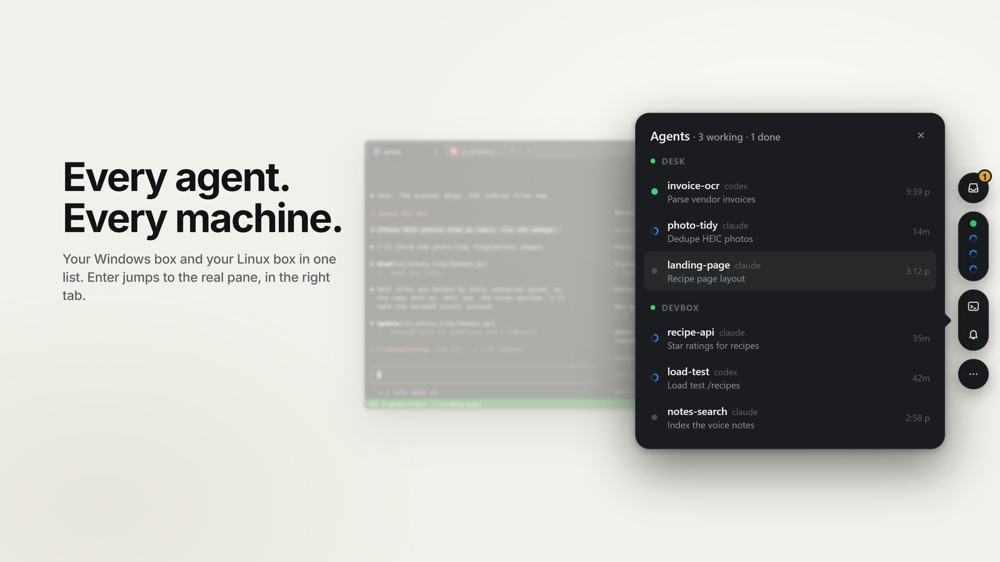

<p align="center">
  <picture>
    <source media="(prefers-color-scheme: dark)" srcset="assets/spiky-cloud-white-small.svg">
    
  </picture>
</p>

# openone

A small Windows edge dock that watches the coding agents (Claude Code, Codex) running in your tmux panes and tells you when one needs you.

It's inspired by [One](https://getone.one/#what-it-is). I loved the side-screen UI and having every agent in one place. But I didn't want a new terminal or a new way of working: I already run psmux in one Windows Terminal tab and ssh + tmux to a Linux box in another. openone just watches those panes and gets out of the way.

[](docs/openone-demo.mp4)

<p align="center"><sub>45 seconds: the dock over psmux and ssh + tmux, answering agents, agents messaging each other, and the phone view. <a href="docs/openone-demo.mp4">Watch the demo</a>.</sub></p>

- **Edge tab**: one dot per active agent. Blue means working, amber means it needs your answer, green means finished.
- **Inbox card**: shows the question or the command waiting for approval. Press `1`–`9` to answer, or type a reply.
- **Toasts and a peek bubble** when an agent finishes or asks something. None for the pane you're already looking at.
- **Click an agent** to select that pane in its real tmux session, switch Windows Terminal to the right tab and bring it forward.

Nothing is installed on the remote machine. openone reads panes with `tmux capture-pane` over one persistent ssh connection, and with `psmux` locally.

## Setup

Needs Node 18+, [just](https://github.com/casey/just), Windows Terminal, [psmux](https://github.com/marlocarlo/psmux) (`winget install marlocarlo.psmux`) for local panes, and ssh key auth to any remote hosts.

```powershell
git clone https://github.com/csaben/openone
cd openone
just install        # or: npm install; npm run dist; then run dist\openone-setup-*.exe
```

That builds a one-click, per-user installer, installs openone, launches it and makes it start at login. Other recipes: `just dev` (run from source), `just push-config`, `just uninstall`. Plain `npm install` + `.\start-openone.cmd` also runs it straight from the checkout.

On first run it writes `config.json` (to `%APPDATA%\openone` for an installed copy). psmux is turned on if it's installed, and every host in `~/.ssh/config` is added but turned off. Set `"enabled": true` on the ones you want, make each `wtTab` regex match that host's Windows Terminal tab title, then choose **Reload config** from the tray. See `config.example.json` for the shape.

**Ctrl+Alt+Space** opens the panel on the agent list, with the most urgent agent selected. **j**/**k** (or the arrow keys) move, **Enter** jumps to the pane, **Tab** switches to the inbox of waiting and finished agents, **r** replies, **1**–**9** answer a question and **Esc** closes. **/** searches agents by name, host or words from their conversation; arrows or Ctrl+j/k pick a match and **Enter** jumps to it. Set `hotkey` in the config to change the shortcut. The tray menu has mute, start at login and config.

### Projects

**n** in the panel starts or continues work in a project folder. Type what you're working on: it matches the folders in each host's `workspace`, or offers a new folder named after what you typed. Add a host name ("drive backup devbox") to pick where it goes. Then choose claude or codex and whether to continue the last chat, and **Enter** opens a new window in the tmux session that host's terminal tab shows, `cd`s into the folder (creating it if new) and starts the agent. **o** opens the folder in VS Code, over Remote-SSH for ssh hosts; **o** on a row of the agent list opens that pane's folder.

Before offering a new folder, the picker checks every host for work that already covers it: agents whose title or output match, and project folders whose name or README match, by words and by meaning. Meaning comes from a small embedding model (all-MiniLM-L6-v2, 8-bit ONNX, 23 MB) run on the CPU through WebAssembly in a worker thread; it downloads on first use, each README summary is embedded once and cached, and a search takes a few milliseconds. `"semantic": false` turns it off.

Per host, `workspace` is the folder that holds your projects (default `~/Code`), and `vscode` the Remote-SSH host name if it differs from `ssh`. The agent commands can be changed with a top-level `agents`, e.g. `{ "claude": { "start": "claude", "resume": "claude --continue" }, "codex": { "start": "codex", "resume": "codex resume --last" } }`.

## Server (web and phone, experimental)

`server/` runs the same watcher on an always-on Linux box. It reaches every machine over ssh, serves the same panel as a web page, and exposes an HTTP API to answer agents and start new sessions. It keeps no state of its own; tmux on each machine is the source of truth.

On the phone, open the same page in a browser over Tailscale, or install the Android app.

**Android app** (`android-app/`, plain Java, no dependencies): the panel in a WebView, plus a background service that holds one connection to the server's event stream over your tailnet. No Google or Expo push service is involved. Whatever needs you becomes a notification you can act on without opening anything:

- questions ([asks](#questions-for-you-asks)): their options as buttons
- an agent waiting at a menu: the menu's options as buttons
- an agent that finished: **Got it** (marks it seen) and an inline **Reply**

A notification clears itself once the item is handled anywhere: on the phone, at the desk or in a terminal. Build it with `cd android-app && ./gradlew assembleRelease` (JDK 17, Android SDK 36), install the APK, and enter the server's address on first launch. Allow it to run in the background when asked, so the connection survives the screen being off. There's no iOS app.

**Sharing between the phone and your computers.** "openone" shows up in the phone's share sheet: share links from any app and they open in the browser on your computer; text goes on its clipboard; files land in its Downloads. When several computers run openone (with `"server"` in their config), it asks which one and remembers. The other way, the tray menu's **Send clipboard to phone** sends text or an image, and Explorer's right-click **Send to > openone (phone)** sends files; on the phone, links and text arrive as a notification with Open/Copy, and files are saved to Downloads. Everything goes through the server (`/api/drops`), which deletes each item once it's received, or after a day.

It keeps itself up to date when the server knows where builds come from. Set `"app": { "builder": "<a clark-expo-style builder>", "project": "<its project id>" }` in the server config; the builder's `GET /api/builds` must list builds with `project`, `status`, `versionCode` and `apkUrl`. The app checks on open and every 30 minutes, notifies you once per new version, and installs it when you tap the notification or **Update app** in the ⋯ menu. Android asks once to allow installs from openone.

```bash
cp server/config.example.json server/config.json    # list your hosts
node server/index.js                                # listens on 127.0.0.1:8950
tailscale serve --bg --https=8951 http://127.0.0.1:8950
```

Host types: `tmux` (the server machine itself), `ssh` (remote tmux) and `ssh-psmux` (remote Windows; give the full path to `psmux.exe`). It is reachable only through `tailscale serve`. Set `allow` to a list of tailnet logins to restrict it further. Anyone who can reach it can type into your shells, so never expose it publicly.

| | |
| --- | --- |
| `GET /api/state` | hosts and every pane with its agent state |
| `GET /api/events` | server-sent events: `state` on change, `peek` when an agent finishes or needs you |
| `GET /api/panes/:key/screen` | current screen text |
| `POST /api/panes/:key/answer` `{n}` · `/reply` `{text}` · `/text` `{text}` · `/keys` `{keys}` · `/focus` · `/seen` | drive a pane |
| `POST /api/hosts/:host/sessions` `{name, cwd, cmd}` | start a detached session and type `cmd` into it |
| `DELETE /api/hosts/:host/sessions/:name` | kill a session |
| `/api/bus/…` `roster` · `send` · `peek` · `projects` · `ls` · `start` · `listen` · `messages` | the agent tools below |
| `/api/asks/…` | questions for you, below |

### Agents talking to each other

`src/mcp.js` is an MCP server (Node, no dependencies) that gives Claude Code and Codex these tools, backed by the openone server:

| | |
| --- | --- |
| `roster` | every agent on every host: name (`label@host`), state, title, last turn's summary, and which one is you |
| `send {to, content}` | message another agent |
| `peek {name, lines}` | read another agent's screen |
| `projects {host}` · `ls {host, path}` | the folders in each host's workspace, and what's inside them |
| `start {host, folder, agent, prompt, create, resume}` | start a new agent in a project, with a first message signed by the caller |
| `ask {title, body, options, default, wait}` | put a question with buttons on your phone and wait for the tap (see [asks](#questions-for-you-asks)) |

A message is typed into the target's chat as `[openone message from <name> …] <text>` once the target is idle, so it never interrupts a turn or a menu waiting for you. A Claude session started with `--dangerously-load-development-channels server:openone` gets it pushed right away as a channel event instead. The panel shows each agent's latest message on its row. A reply chain stops after 6 hops between agents until you step in (answering, replying or opening the agent resets it), and an agent can send 30 messages per 10 minutes.

The tool finds its own pane from `$TMUX_PANE`, so messages carry a sender. Register it on each machine, pointing at the server:

```bash
claude mcp add -s user openone -e OPENONE_URL=https://<server>:8951 -- node /path/to/openone/src/mcp.js
```

```toml
# ~/.codex/config.toml
[mcp_servers.openone]
command = "node"
args = ["/path/to/openone/src/mcp.js"]
env = { OPENONE_URL = "https://<server>:8951" }
env_vars = ["TMUX", "TMUX_PANE", "PSMUX_SESSION"]
```

`OPENONE_HOST` overrides the host name the tool reports (default: the machine's hostname, which should match the host's `name` in the server config). On the desktop app, `"server": "https://<server>:8951"` in the config shows the messages in the panel.

A message typed into a pane reads like a prompt from you, so any agent can steer any other. The tool tells agents to treat these as requests from a sibling, not from you, and every message is logged, but only use this between agents you'd let act on each other's behalf.

### Sleep and wake

Fewer agents lying around, none lost. In the web panel and the app, each idle agent has a moon button, and **Tidy up** picks every agent that's been idle for over an hour so you can put them all to sleep at once. Sleeping an agent types `/exit` (Codex: `/quit`), reads the resume command it prints on the way out, closes its window and lists it under **Sleeping**. **Wake** opens a window in the same folder with `claude --resume <id>` / `codex resume <id>`, built on your configured start command so its flags stay. Only idle agents can sleep, not ones working or waiting on you. The list is kept in `~/.local/state/openone/sleeping.json`.

`POST /api/panes/:key/sleep` · `POST /api/sleeping/:id/wake` · `DELETE /api/sleeping/:id` (forget it)

### Questions for you (asks)

Anything can put a question with up to four buttons in front of you: "Add Dentist Thu 3pm to your calendar? Add / Skip". It shows at the top of the panel's inbox, and you answer with one tap or a number key, without opening a chat.

- **Agents** use the MCP `ask` tool. It waits up to 45 seconds for your answer; if you answer later, the answer is typed into the agent's chat as `[openone] The user answered …`.
- **Scripts** run `node src/ask-cli.js "Add Dentist Thu 3pm?" -o Add -o Skip`, which prints the label you picked (exit 2 if it expired). Or they call the HTTP API directly:

| | |
| --- | --- |
| `POST /api/asks` `{title, body, options, default, ttlSec, tag, callback, from}` | ask; returns the ask with its `id` |
| `GET /api/asks/:id?wait=55` | long-poll until it's answered |
| `POST /api/asks/:id/answer` `{option}` | answer by option id, label or number |
| `GET /api/asks` · `DELETE /api/asks/:id` | what's pending · withdraw one |

`default` applies by itself when the ask expires (after `ttlSec`, one day by default), which suits "Added Dentist Thu 3pm · Keep / Undo". With a `tag`, asking again while one is pending returns that one instead of a duplicate. `callback` gets the answered ask POSTed to it. Pending asks are kept in `~/.local/state/openone/asks.json`, so they survive a restart.

## Notes

- Agent state comes from reading the screen. A spinner line above the input box (or "esc to interrupt") means working, and a numbered menu with a cursor means waiting on you. `npm test` runs against real captured Claude Code screens.
- On psmux, panes are streamed rather than polled: one control-mode client per session (`psmux -C attach`) feeds each pane's output into a headless terminal emulator, because every `capture-pane` can flash the attached terminal. Each pane is read once when openone first sees it. Set `"stream": false` on a host to go back to polling.
- psmux pane ids repeat across sessions, so openone always targets `session:window.%id`.
- `npx electron tools/render-icons.js` rebuilds the PNG icons from `assets/*.svg`.

## License

MIT. See [LICENSE](LICENSE).
